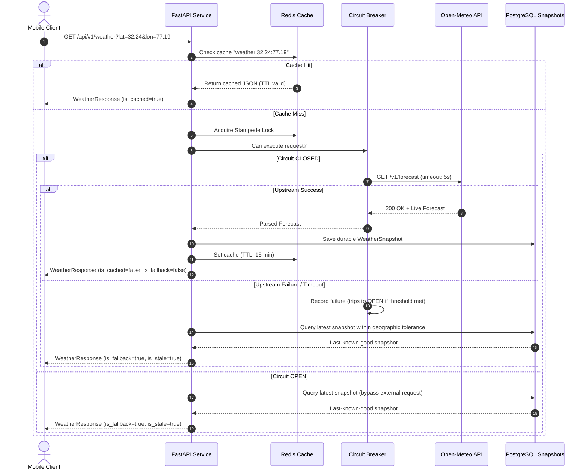
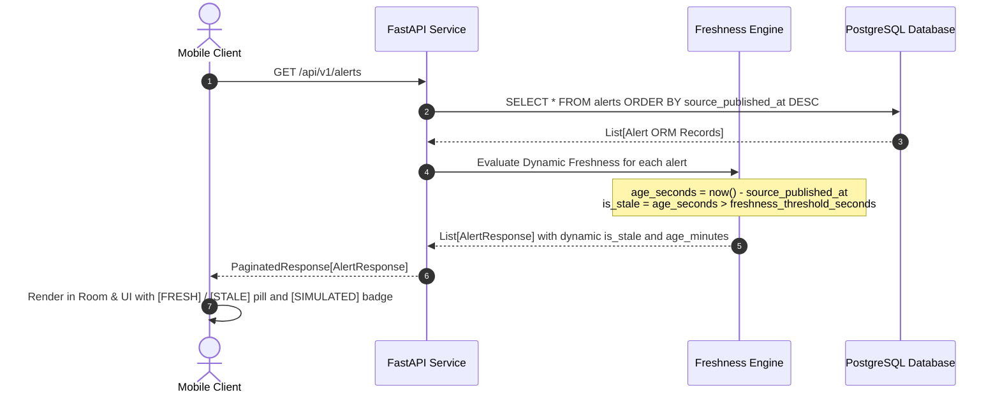
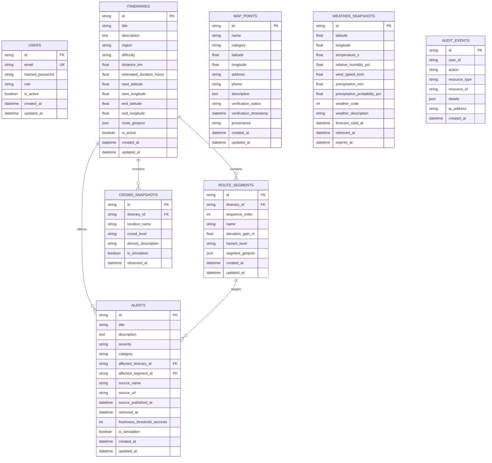

# System Architecture: Tourist Safety & Assistance Platform

## 1. System Overview

The **Tourist Safety & Assistance Platform** is an offline-first mobile safety and navigation platform designed for alpine and wilderness tourists. It features a native Android frontend built with Kotlin and Jetpack Compose Material 3, and a modular monolith backend built with FastAPI, PostgreSQL/PostGIS, and Redis.

```mermaid
graph TD
    subgraph "Android Mobile Client (Kotlin)"
        UI[Jetpack Compose Material 3 UI\nHome | Map | Alerts | Emergency | Saved]
        VM[ViewModels\nStateFlow State Management]
        Repo[Offline-First Repositories\nItinerary | Alert | Weather | Emergency]
        Room[(Room Database\nLocal Single Source of Truth)]
        MapLibre[MapLibre Native Android SDK\nVector Map Renderer]
        WM[WorkManager\nConstraint-Aware Periodic Sync]
    end

    subgraph "Backend API (FastAPI + Python 3.11)"
        API[FastAPI Endpoints /api/v1/*]
        Middleware[Correlation ID | Rate Limiter | Structured Error Handler]
        Services[Application Services\nAlert | Weather | Itinerary | Emergency]
        Cache[Redis Cache-Aside & Stampede Lock]
        Worker[ARQ Background Worker]
    end

    subgraph "Durable Storage & Infrastructure"
        PG[(PostgreSQL + PostGIS\nSpatial Indexes)]
        Redis[(Redis 7\nCache & Job Queue)]
    end

    subgraph "External Providers (Free & Open-Source)"
        OFM[OpenFreeMap Vector Tiles\nLiberty Style]
        OpenMeteo[Open-Meteo Weather API\nCC BY 4.0]
        ERSS[National Emergency Registry 112]
    end

    UI --> VM
    VM --> Repo
    Repo --> Room
    Repo --> API
    WM --> Repo
    MapLibre --> OFM

    API --> Middleware
    Middleware --> Services
    Services --> Cache
    Cache --> Redis
    Services --> PG
    Services --> OpenMeteo
    Worker --> Redis
    Worker --> PG
    Worker --> OpenMeteo
```

---

## 2. Data Flow Architecture

### 2.1 Weather Forecast Retrieval & Circuit Breaker Flow



---

### 2.2 Alert Dynamic Freshness Engine Flow



---

## 3. Database Entity Relationship Diagram



---

## 4. Key Architectural Decisions (ADR)

1. **Room as Single Source of Truth for Mobile**:
   The Android UI never binds directly to volatile network requests. All network responses are transactionally written to Room, and UI components observe Room `Flow` streams. If network calls fail, the existing cached state remains seamlessly visible without crashing.

2. **Dynamic Alert Freshness vs Static Stored Booleans**:
   `is_stale` is computed at request time and UI render time (`(now - source_published_at) > threshold`). This ensures that an alert that was fresh 30 minutes ago correctly transitions to stale without requiring write locks or database cron triggers.

3. **OpenFreeMap Liberty Style & Bounded Vector Strategy**:
   MapLibre Native Android SDK renders vector tiles directly from OpenFreeMap (`https://tiles.openfreemap.org/styles/liberty`). Downloads are bounded by OpenFreeMap terms (maximum 3,000 tiles or 50 MB, <= 4 concurrent threads). Additionally, the application renders a pure vector schematic canvas offline so route geometry and waypoints remain 100% accessible even when no basemap tiles are present.

4. **Multi-Layer Cache-Aside with Degraded Mode**:
   Redis caches weather and geographic queries. If Redis crashes or is stopped, the application seamlessly operates in degraded in-memory mode without terminating active user requests.

5. **Privacy by Design**:
   Tourists' GPS coordinates are processed exclusively on-device for finding nearest emergency points. The backend does not log, persist, or track tourist locations.

