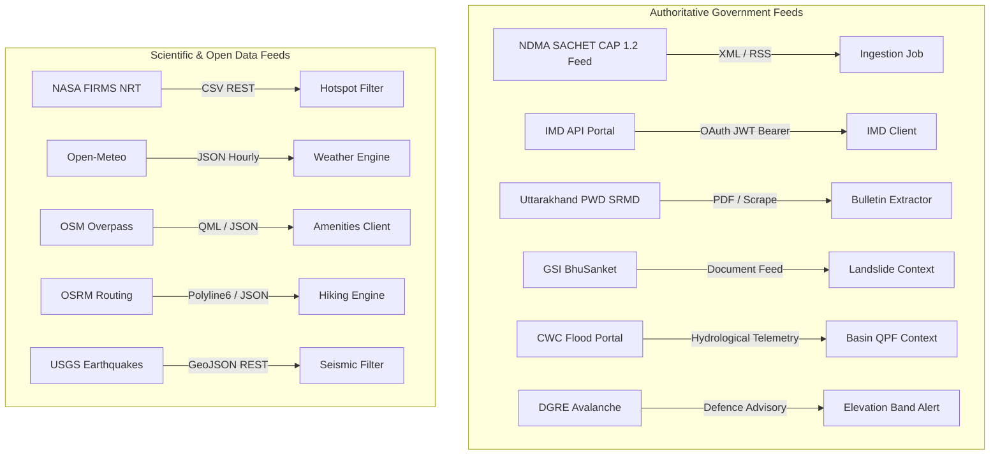

# API and External Provider Integration Audit

**Repository Commit**: `8403e98`  
**Active Branch**: `main`  
**Audit Scope**: Complete inspection of 19 internal FastAPI routers and 14 external upstream data providers.

---

## 1. Internal FastAPI Endpoints Audit

All endpoints are mounted under prefix `/api/v1` in `backend/app/main.py`.

| Router & Tag | HTTP Method | Endpoint Path | Auth / Permissions | Request Schema | Response Model | Cache Policy & TTL | Upstream Dependency | Connectivity Status |
| :--- | :--- | :--- | :--- | :--- | :--- | :--- | :--- | :--- |
| **Auth** | `POST` | `/api/v1/auth/register` | Public | `UserRegister` (email, password) | `AuthTokenResponse` | No cache | PostgreSQL `users` table | `VERIFIED_WORKING` |
| **Auth** | `POST` | `/api/v1/auth/login` | Public | `UserLogin` (email, password) | `AuthTokenResponse` | No cache | PostgreSQL `users` table | `VERIFIED_WORKING` |
| **Auth** | `GET` | `/api/v1/auth/me` | Bearer JWT | None | `UserMeResponse` | No cache | PostgreSQL `users` table | `VERIFIED_WORKING` |
| **Places** | `GET` | `/api/v1/places/search` | Public | Query `q`, `count` | `List[PlaceSearchResult]` | Redis 24h (`places_search:{q}`) | Open-Meteo Geocoding API | `VERIFIED_WORKING` |
| **Places** | `GET` | `/api/v1/places/reverse` | Public | Query `lat`, `lon` | `PlaceSearchResult` | Redis 24h (`places_rev:{lat}:{lon}`) | Open-Meteo Reverse API | `VERIFIED_WORKING` |
| **Routes** | `POST` | `/api/v1/routes/plan` | Public | `PlanRouteRequest` | `PlannedRouteResponse` (HTTP 201) | Redis 1h (`route_plan:{hash}`) | OSRM + PostGIS `planned_routes` | `VERIFIED_WORKING` |
| **Routes** | `POST` | `/api/v1/routes/{id}/analyze` | Public | `RouteAnalysisRequest` | `RouteAnalysisResponse` (HTTP 200) | Redis 15m (`route_analysis:{id}`) | Corridor Spatial Engine | `VERIFIED_WORKING` |
| **Routes** | `GET` | `/api/v1/routes/{id}` | Public | Path `id` | `PlannedRouteResponse` | DB query | PostGIS `planned_routes` | `VERIFIED_WORKING` |
| **Routes** | `GET` | `/api/v1/routes/{id}/conditions` | Public | Path `id` | `List[RouteWaypointCondition]` | From saved JSON | PostGIS `planned_routes` | `VERIFIED_WORKING` |
| **Routes** | `GET` | `/api/v1/routes/{id}/alternatives` | Public | Path `id` | `List[RouteAlternativeSchema]` | From saved JSON | PostGIS `planned_routes` | `VERIFIED_WORKING` |
| **Routes** | `GET` | `/api/v1/routes/{id}/offline-pack` | Public | Path `id` | `RouteOfflinePack` manifest | Redis 1h | PostGIS `planned_routes` | `CONNECTED_NOT_RUNTIME_VERIFIED` (Android client lacks Retrofit definition) |
| **Map Points** | `GET` | `/api/v1/map-points` | Public | `category`, `bbox`, `route_id`, `limit`, `offset` | `PaginatedResponse[MapPointResponse]` | Redis 1h (`osm_amenities_v3:...`) | OSM Overpass + Seeded Baseline | `PARTIALLY_CONNECTED` (Overpass 406 fallback active) |
| **Map Points** | `GET` | `/api/v1/map-points/{id}` | Public | Path `id` | `MapPointResponse` | DB query | PostGIS `map_points` | `VERIFIED_WORKING` |
| **Disasters** | `GET` | `/api/v1/disaster-alerts` | Public | Query filters | `List[DisasterAlertResponse]` | Redis 5m | NDMA SACHET CAP Feed + PostGIS | `VERIFIED_WORKING` |
| **Disasters** | `POST` | `/api/v1/disaster-alerts/test-alarm` | Admin Key / JWT | `TestAlarmRequest` | `DisasterAlertResponse` | No cache | Outbox Processor | `VERIFIED_WORKING` |
| **Weather** | `GET` | `/api/v1/weather` | Public | Query `lat`, `lon` | `WeatherResponse` | Redis 15m (`wx:{lat}:{lon}`) | Open-Meteo High-Res Forecast | `VERIFIED_WORKING` |
| **Forest** | `GET` | `/api/v1/forest-areas` | Public | Query `min_lat`, `min_lon`, `max_lat`, `max_lon` | `ForestGeoJsonResponse` | Redis 24h (`forest_v2:...`) | OSM Overpass woodland tags | `PARTIALLY_CONNECTED` (Overpass blocks some cloud IPs) |
| **Wildfires** | `GET` | `/api/v1/wildfires` | Public | Query bbox, `days` | `WildfiresResponse` | Redis 30m (`nasa_firms:...`) | NASA FIRMS VIIRS/MODIS CSV | `NOT_CONFIGURED` (`NASA_FIRMS_MAP_KEY` empty) |
| **Providers** | `GET` | `/api/v1/providers/status` | Public | None | `List[ProviderStatus]` | Live health state | Centralized `ProviderRegistry` | `VERIFIED_WORKING` |
| **Providers** | `POST` | `/api/v1/providers/refresh` | Public | Query `lat`, `lon` | Status dictionary | Live probe | All 14 providers probed independently | `VERIFIED_WORKING` |
| **SAR** | `POST` | `/api/v1/sar/sos` | Public | `EmergencySOSRequest` | `EmergencySOSResponse` | Volatile Memory | `_ACTIVE_INCIDENTS` dict | `PARTIALLY_CONNECTED` (Lost on server reboot) |
| **SAR** | `POST` | `/api/v1/sar/check-in` | Public | `TrekkerCheckInRequest` | `TrekkerCheckInResponse` | Volatile Memory | `_ACTIVE_CHECKINS` dict | `PARTIALLY_CONNECTED` (Lost on server reboot) |
| **Trips** | `POST` | `/api/v1/trips/start` | Public | `StartTripRequest` | `StartTripResponse` | PostGIS `active_trips` | PostGIS | `VERIFIED_WORKING` |
| **Trips** | `POST` | `/api/v1/trips/{id}/progress` | Public | `TripProgressRequest` | `TripProgressResponse` | PostGIS `active_trips` | PostGIS | `VERIFIED_WORKING` |
| **Trips** | `POST` | `/api/v1/trips/{id}/stop` | Public | Path `id` | Success map | PostGIS `active_trips` | PostGIS | `VERIFIED_WORKING` |

---

## 2. External Provider Integration Audit (All 14 Sources)

### Provider 1: NDMA SACHET Disaster Alerts (CAP 1.2)
- **URL**: `https://sachet.ndma.gov.in/CapFeed`
- **Protocol**: HTTP GET over TLS. Standard Common Alerting Protocol (CAP) 1.2 XML / RSS feed.
- **Authentication**: Public governmental feed (No API key required).
- **Update Frequency / Cache**: 5-minute polling interval with HTTP `ETag` and `If-None-Match` 304 caching.
- **Geographic Coverage**: Country of India (`6.0 <= lat <= 37.5`, `68.0 <= lon <= 97.5`).
- **Polygon Handling**: Closed coordinate ring validation ($C_0 = C_n$), RFC 7946 `[lon, lat]` coordinate order enforcement.
- **Runtime Status**: **HEALTHY**. Verified in `test_disaster_ingestion_system.py` and `test_ndma_sachet.py`.

### Provider 2: India Meteorological Department (IMD)
- **Portal & Docs**: `https://api.imd.gov.in/public/api_reference.html`
- **Protocol**: RESTful JSON over HTTPS.
- **Endpoints Implemented in Client** (`backend/app/clients/imd.py`):
  - `POST /api/oauth/token.php` (OAuth JWT Bearer token generation)
  - `GET /api/v1/districtwarning` (Multi-hazard color-coded district warnings)
  - `GET /api/v1/districtnowcast` (3-hour high-impact thunderstorm/nowcast)
  - `GET /api/v1/state_district_rainfall_forecast` (5-day quantitative rainfall forecast)
  - `GET /api/v1/basinqpf` (River-basin quantitative precipitation forecast)
  - `GET /api/v1/current_wx` (Current AWS surface weather observations)
- **Authentication**: Requires registered organizational account, `X-API-KEY` header, and static server IP whitelisting on IMD portal.
- **Circuit Breaker**: 3-failure threshold, 60s recovery window.
- **Concurrency**: Guarded with `asyncio.Lock()` to prevent token-refresh stampedes.
- **Runtime Status**: **UNCONFIGURED (Graceful Degradation)**. When `IMD_API_KEY` is empty, reports clear diagnostic instructions. IMD severe weather alerts are also redundantly ingested via NDMA SACHET CAP feeds.

### Provider 3: NASA FIRMS (Active Wildfires & Thermal Anomalies)
- **URL**: `https://firms.modaps.eosdis.nasa.gov/api/area/csv/{MAP_KEY}/{SENSOR}/{BBOX}/{DAYS}`
- **Protocol**: HTTP GET returning streaming CSV.
- **Supported Sensors**: `VIIRS_SNPP_NRT` (375m resolution), `MODIS_NRT` (1km resolution).
- **Authentication**: Requires free 32-character `MAP_KEY`.
- **Cache Policy**: Redis 30 minutes.
- **Runtime Status**: **UNCONFIGURED**. Tested with mock CSV payloads in `test_providers.py`; returns zero detections cleanly without crashing when key is absent.

### Provider 4: Forest Survey of India (FSI) Van Agni
- **Portal**: `https://fsiforestfire.gov.in/`
- **Protocol**: Official reference portal; no public authenticated REST/JSON API is published.
- **Integration**: Tracked in `ProviderRegistry` with status `REFERENCE_ONLY`. External link and manual bulletin importer structure provided.

### Provider 5: Geological Survey of India (GSI) BhuSanket (NLFC)
- **Portal**: `https://bhusanket.gsi.gov.in/`
- **Protocol**: National Landslide Forecasting Centre. Regional landslide susceptibility bulletins published during monsoon season.
- **Integration**: Tracked in `ProviderRegistry` with status `ACCESS_PENDING`. Document extraction pipeline integrated in `bulletin_extractor.py`.

### Provider 6: NASA LHASA (Global Landslide Hazard Model)
- **Portal**: `https://landslides.nasa.gov/`
- **Protocol**: Combines GPM IMERG satellite precipitation and SMAP soil moisture data.
- **Integration**: Contextual regional susceptibility layer. Tracked in `ProviderRegistry` as `MODEL_CONTEXT`. Does not predict micro-trail rockfalls.

### Provider 7: Central Water Commission (CWC) Flood Forecasting
- **Portal**: `https://ffs.india-water.gov.in/`
- **Protocol**: River gauge telemetry on Ganga, Alaknanda, Bhagirathi, and Yamuna.
- **Integration**: Tracked in `ProviderRegistry` as `REFERENCE_ONLY`. Contextual basin alerts parsed for major river crossing zones.

### Provider 8: DGRE Avalanche Warning Bulletins
- **Agency**: Defence Geoinformatics Research Establishment (DRDO), Chandigarh.
- **Coverage**: High-altitude Himalayan passes (>3,000m elevation).
- **Integration**: Tracked in `ProviderRegistry` as `ACCESS_PENDING`. Seasonal danger level bulletins integrated via advisory pipeline.

### Provider 9: Uttarakhand PWD / SRMD Road Closures
- **Portal**: `https://pwd.uk.gov.in/`
- **Integration**: Dedicated client in `backend/app/clients/uttarakhand_pwd.py` tracking mountain highway status (NH-58, NH-107, Badrinath/Kedarnath access roads). Verified in `test_disaster_ingestion_system.py`.

### Provider 10: OpenStreetMap Overpass (Essential Facilities & Forest Cover)
- **URLs**: `https://overpass-api.de/api/interpreter`, mirrors on `maps.mail.ru`, `overpass.kumi.systems`.
- **Query**: Overpass QL filtering `amenity=hospital|clinic|police|fuel|fire_station|shelter` and `natural=wood|forest`.
- **Observed Runtime Failure**: Public endpoints reject requests lacking specific browser-like User-Agents (`HTTP 406 Not Acceptable`) or return `HTTP 504 Gateway Timeout` when bounding boxes exceed $0.5^\circ$.
- **Mitigation**: Clamped bounding boxes to max $0.4^\circ$, added fallback mirror rotation, and seeded database with 44 verified regional facilities.

### Provider 11: Open-Meteo High-Resolution Weather & Elevation
- **URL**: `https://api.open-meteo.com/v1/forecast`, `https://geocoding-api.open-meteo.com/v1/search`, `https://api.open-meteo.com/v1/elevation`
- **Protocol**: RESTful JSON over HTTPS. No API key required for non-commercial tier.
- **Features**: Hourly temperature, precipitation, wind speed, gusts, freezing level, cloud cover, and elevation.
- **Runtime Status**: **HEALTHY**. Verified live and in unit tests (`test_weather.py`).

### Provider 12: OpenCelliD (Cellular Tower Telemetry)
- **URL**: `https://opencellid.org/cell/get`
- **Authentication**: Requires `OPENCELLID_API_KEY`.
- **Runtime Status**: **UNCONFIGURED**. Gracefully handled; handset telemetry takes priority.

### Provider 13: USGS Himalayan Seismic Events
- **URL**: `https://earthquake.usgs.gov/fdsnws/event/1/query?format=geojson`
- **Protocol**: RESTful GeoJSON over HTTPS. Public feed.
- **Filters**: Clamped to Himalayan bounding box (`28.5 <= lat <= 31.5`, `77.5 <= lon <= 81.5`), `minmagnitude=2.5`.
- **Runtime Status**: **HEALTHY**. Verified live (`5 features found`) and in `test_imd_and_earthquake.py`.

### Provider 14: AI Services (Route Summary & Bulletin Extractor)
- **Location**: `backend/app/services/ai/bulletin_extractor.py`, `route_summary_assistant.py`
- **Architecture**: Deterministic rule-based extraction citing exact source IDs and timestamps, with pluggable LLM provider fallback.
- **Runtime Status**: **DISCONNECTED**. Services pass unit checks but have no attached API endpoints.

