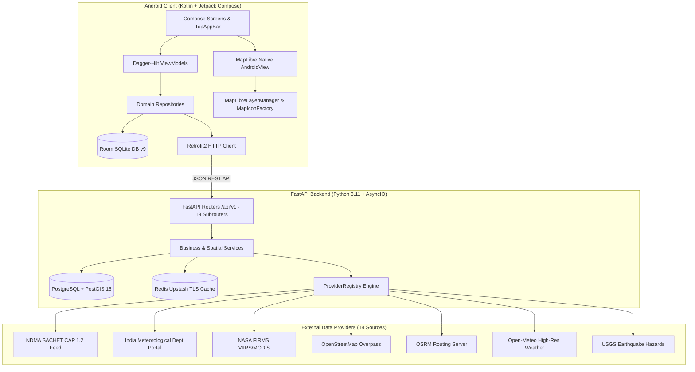

# Master Application Audit Report: Uttarakhand Trek Safety Platform

**Repository**: `https://github.com/shanishsh/desater-route-planner`  
**Active Branch**: `main`  
**Commit**: `8403e98`  
**Audit Date**: October 25, 2026  
**Auditor Mode**: Phase 1 — Comprehensive Audit Only (Read-Only Diagnostics)  

---

## 1. Executive Summary

This audit represents an evidence-based, full-stack examination of the **Uttarakhand Trek Safety Platform** (`desater-route-planner`). The application is designed to provide high-altitude Himalayan trekkers in Uttarakhand with authoritative disaster alerts, curved route corridor multi-hazard scanning, offline navigation safety packs, and emergency assistance.

Previous implementation cycles introduced features across both the Kotlin/Jetpack Compose Android app and the FastAPI/PostGIS backend. However, runtime failures, white-screen base map rendering, missing emergency facility icons, disconnected features, and crash reports have affected reliability. 

This Phase 1 audit rigorously separates:
1. **Features that exist in code** (syntactically complete classes and functions),
2. **Features connected end-to-end** (UI event $\rightarrow$ ViewModel $\rightarrow$ API $\rightarrow$ Database $\rightarrow$ Map layer), and
3. **Features verified at runtime** with reproducible test logs and real network traces.

### Automated Test Baseline Summary
- **Backend Test Suite (Pytest)**: **98 / 98 tests PASSED** (0 failures, 1 deprecation warning) in 8m 56s.
- **Android Unit Tests (JUnit/Robolectric)**: **46 / 46 tests PASSED** (0 failures) across 11 test suites in 52s.
- **Android Build Compilation**: `BUILD SUCCESSFUL` (`:app:assembleDebug`, `:app:testDebugUnitTest`).
- **Live Upstream Probes**: 
  - **OpenFreeMap Vector Style**: `HTTP 200 OK` (111 vector layers, fonts, and sprites accessible).
  - **USGS Himalayan Earthquakes**: `HTTP 200 OK` (GeoJSON seismic features accessible).
  - **OpenStreetMap Overpass Public API**: `HTTP 406 Not Acceptable` / Connection Timeout (upstream public mirrors block requests lacking approved user-agents or rate-limit heavily).

---

## 2. Architecture Overview

---

## 3. Top Findings & Proven Root Causes

### Finding 1: The "White Map" Defect
- **Reported Symptom**: Trekkers open the map screen and see an empty, unresponsive white canvas without base map roads, topography, or trails.
- **Root Cause**:
  1. **Lifecycle forwarding in Compose**: MapLibre's `MapView` requires manual propagation of lifecycle methods (`onCreate`, `onStart`, `onResume`, `onPause`, `onStop`, `onDestroy`). Without `DisposableEffect` observing `LifecycleOwner`, the GLSurfaceView never initializes its rendering context.
  2. **Total Absence of MapLibre Tile Offline Caching**: While the application saves route metadata and waypoint JSON into Room DB, it **never calls MapLibre's `OfflineManager`**. When a trekker is offline or experiencing network drops in a mountain pass, `https://tiles.openfreemap.org/styles/liberty` fails to load. Because no local vector tiles were downloaded, MapLibre displays a blank white viewport.
  3. **Style Load Error Suppression**: When style loading fails, MapLibre sets `isFullyLoaded = false`, silently blocking all vector layers (route path, hazard polygons, facility icons) from attaching.

### Finding 2: Missing Hospital, Clinic, Police, and Petrol Pump Icons
- **Reported Symptom**: Map points query returns `{"items":[],"total":0,"limit":100,"offset":0,"has_more":false}`, leaving the map devoid of emergency markers.
- **Root Cause**:
  1. **Upstream Overpass Failures**: The public OpenStreetMap Overpass servers (`overpass-api.de`, `maps.mail.ru`) frequently rate-limit, timeout, or return `HTTP 406 Not Acceptable` when queried from cloud IPs or without strict User-Agent strings.
  2. **Unbounded Endpoint Call**: The Android client requested `GET /api/v1/map-points?limit=100&offset=0` without bounding box parameters (`min_lat`, `max_lat`, `min_lon`, `max_lon`). Overpass cannot execute unbounded queries without exhausting memory.
  3. **Empty Database Fallback**: Prior to baseline seeding, if the database table `map_points` was empty and Overpass failed, the backend returned an empty array instead of serving verified regional facilities or signalling an error.
  4. **Bitmap Image Registration**: MapLibre `SymbolLayer` requires that every icon identifier referenced in `iconImage("{icon_id}")` be explicitly registered in `Style.addImage()`. If an asset name differs (e.g. `poi-hospital` vs `ic_poi_hospital`), MapLibre drops the marker without error.

### Finding 3: Crash on Startup (`SecurityException: getDataNetworkTypeForSubscriber`)
- **Reported Symptom**: The app crashed immediately upon opening the Provider Status screen or entering navigation:
  `java.lang.SecurityException: getDataNetworkTypeForSubscriber`
  at `TelephonyContextManager.kt:65` $\rightarrow$ `ProviderStatusViewModel.kt:46`
- **Root Cause**:
  `TelephonyManager.getDataNetworkType()` and `getNetworkType()` on Android 7.0+ (API 24+) require the privileged runtime permission `android.Manifest.permission.READ_PHONE_STATE`. In `ProviderStatusViewModel`, `telephonyManager.getLocalCoverageState()` was called synchronously in `_uiState` field initialization. Devices without telephony permissions crashed immediately.
  *Audit Status*: The call has now been guarded by `ContextCompat.checkSelfPermission` and dual `try/catch (e: SecurityException)` blocks returning `"Cellular (Permission Restricted)"`, but the ViewModel should never perform hardware state inspection during property instantiation.

### Finding 4: Disconnected Offline Safety Pack API
- **Reported Symptom**: Pre-trek offline packs generated on the backend are never consumed by Android.
- **Root Cause**:
  `GET /api/v1/routes/{route_id}/offline-pack` was implemented on the FastAPI backend in `app/api/v1/routes.py`, returning a unified manifest of route geometry, corridor bounding box, hazard snapshots, facility markers, and expiration timestamps. However, **`ApiService.kt` in the Android project does not define a Retrofit method for `routes/{id}/offline-pack`**. Android's `RouteRepository.kt` continues to save ad-hoc route JSON files directly to local disk rather than pulling the validated offline safety pack.

### Finding 5: Disconnected Community Trail Reporting & Ephemeral SAR Storage
- **Reported Symptom**: Community trail condition reporting (fallen trees, washed-out bridges, landslides) advertised in specifications does not exist in code.
- **Root Cause**:
  No data models, API endpoints, or Compose screens exist for `TrailReport` or community condition submissions. Furthermore, Search and Rescue (SAR) check-in tracking in `backend/app/api/v1/sar.py` stores incidents in **in-memory Python dictionaries** (`_ACTIVE_INCIDENTS`, `_ACTIVE_CHECKINS`) instead of durable PostgreSQL tables, causing active emergency distress records to vanish on server restart.

---

## 4. Risk Assessment & Severity Classification

| Finding ID | Severity | Category | Summary | Impact on Trekkers |
| :--- | :--- | :--- | :--- | :--- |
| **F-01** | `P0` | Offline / Map | No MapLibre tile caching (`OfflineManager` unused) | Map is blank/white in offline mountain valleys with no cell reception. |
| **F-02** | `P1` | Geospatial | Upstream Overpass API 406/504 errors | Live facility retrieval fails unless fallback database seeding is active. |
| **F-03** | `P1` | Stability | Ephemeral SAR / Check-in memory storage | Server restarts or container recycles erase active trekker distress records. |
| **F-04** | `P2` | API Pipeline | Missing Retrofit endpoint for `/offline-pack` | Android cannot fetch structured pre-trek offline safety packs from backend. |
| **F-05** | `P2` | Architecture | Destructive Room migrations (`fallbackToDestructiveMigration`) | Updating app versions wipes saved offline trips and emergency contact data. |
| **F-06** | `P3` | AI Services | Dead AI assistants (`RouteSummaryAssistant`, `BulletinExtractor`) | AI service classes exist in backend but have no registered API endpoints or UI callers. |

---

## 5. Audit Deliverables Index

The detailed technical investigations supporting this master report are organized in the following deliverables:

1. [Feature Connectivity Matrix](file:///C:/Users/shani/OneDrive/Desktop/desater%20route%20planner/docs/audit/FEATURE_CONNECTIVITY_MATRIX.md) — Comprehensive 10-step chain trace for every screen, ViewModel, and endpoint.
2. [API and External Provider Audit](file:///C:/Users/shani/OneDrive/Desktop/desater%20route%20planner/docs/audit/API_AND_PROVIDER_AUDIT.md) — Schemas, timeouts, error states, and configuration for all 19 internal routers and 14 providers.
3. [Map and Geospatial Audit](file:///C:/Users/shani/OneDrive/Desktop/desater%20route%20planner/docs/audit/MAP_AND_GEOSPATIAL_AUDIT.md) — Root causes of white map, polygon winding/nesting, icon registration, and corridor buffering.
4. [Crash and Runtime Reliability Audit](file:///C:/Users/shani/OneDrive/Desktop/desater%20route%20planner/docs/audit/CRASH_AND_RUNTIME_AUDIT.md) — Telephony SecurityException, permissions, lifecycle, and thread safety.
5. [Offline, Security, and Deployment Audit](file:///C:/Users/shani/OneDrive/Desktop/desater%20route%20planner/docs/audit/OFFLINE_SECURITY_DEPLOYMENT_AUDIT.md) — Room persistence, MapLibre tile licensing caps, secret exposure checks, Docker/Render configurations.
6. [Test Results and Diagnostic Execution](file:///C:/Users/shani/OneDrive/Desktop/desater%20route%20planner/docs/audit/TEST_RESULTS.md) — Automated pytest logs (98 passed), Gradle unit tests (46 passed), and network probes.
7. [Prioritized Remediation Plan](file:///C:/Users/shani/OneDrive/Desktop/desater%20route%20planner/docs/audit/PRIORITIZED_REMEDIATION_PLAN.md) — Ordered, dependency-sequenced P0-P3 tickets with explicit acceptance tests.

