# Map and Geospatial System Audit

**Repository Commit**: `8403e98`  
**Active Branch**: `main`  
**Audit Priority**: Critical (High impact on trekker navigation safety)

---

## 1. Base Map Rendering Pipeline Audit

```mermaid
flowchart TD
    subgraph Online_Flow["Online Base Map Pipeline"]
        A1[MapView initialized in Compose] --> A2[Lifecycle forwarder onStart/onResume]
        A2 --> A3[Fetch Style: tiles.openfreemap.org/styles/liberty]
        A3 -->|HTTP 200| A4[Load Fonts / Glyphs & Sprites]
        A4 --> A5[MapLibre style.isFullyLoaded = true]
        A5 --> A6[Attach Route & Hazard Layers]
    end

    subgraph Offline_Flow["Offline Base Map Pipeline (Current Defect)"]
        B1[Trekker in Mountain Valley / Airplane Mode] --> B2[MapView initialized]
        B2 --> B3[Fetch Style: tiles.openfreemap.org]
        B3 -->|Network Error / Timeout| B4[style.isFullyLoaded = false]
        B4 --> B5[CRITICAL DEFECT: White / Blank Viewport]
        B5 --> B6[Fallback: 2D OfflineVectorCanvasView or Raster]
    end
```



### A. Base Map Health & Configuration
- **Map SDK**: MapLibre Native Android (`org.maplibre.gl:android-sdk:11.5.2`) running inside Jetpack Compose via `AndroidView`.
- **Default Vector Style**: `https://tiles.openfreemap.org/styles/liberty` (defined in `MapConfig.kt` via `BuildConfig.MAP_STYLE_URL`).
- **Live Probe Findings**:
  - OpenFreeMap style endpoint responded with `HTTP 200 OK`.
  - Style JSON contains 111 layers and 2 sources (`openmaptiles` vector tiles and `ne2_shaded` hillshade raster).
  - Glyphs URL: `https://tiles.openfreemap.org/fonts/{fontstack}/{range}.pbf`
  - Sprite URL: `https://tiles.openfreemap.org/sprites/ofm_f384/ofm`
- **Initial Camera Target**: Lat: `30.6534`, Lon: `79.0268`, Zoom: `13.0` (Gaurikund trailhead for the Kedarnath pilgrimage corridor).

### B. Root Causes of the "White Map" Experience
1. **GLSurfaceView Lifecycle Teardown in Compose**:
   When `MapView` was embedded inside `AndroidView` without manual forwarding of `onStart()`, `onResume()`, `onPause()`, `onStop()`, and `onDestroy()`, the underlying GL rendering thread was torn down during Compose recomposition, leaving a blank white container.
   *Resolution in current code*: `MapScreen.kt` implements a full `LifecycleEventObserver` forwarding all lifecycle events safely.
2. **Missing `OfflineManager` Vector Tile Caching**:
   OpenFreeMap permits offline tile downloads for individual treks (capped at 3,000 tiles or 50 MB per offline pack). However, **the application never initializes MapLibre's `OfflineManager`**. As a result, no vector tiles, glyphs, or sprites are saved to `mbgl-offline.db`. When an internet connection is unavailable, the vector style cannot load, leaving the map completely blank.
3. **Style Load Error Blocking Overlay Layers**:
   MapLibre strictly rejects layer and source additions before `style.isFullyLoaded == true`. When the base style failed to load, `MapLibreLayerManager.setupSourcesAndLayers()` aborted silently, preventing even locally available GeoJSON route lines and markers from drawing.
4. **Fallback Raster & 2D Canvas Fallback**:
   `MapScreen.kt` now provides:
   - `switchToFallbackRaster`: switches from vector Liberty style to standard OpenStreetMap raster tiles (`MapConfig.OSM_RASTER_STYLE_JSON`).
   - `OfflineVectorCanvasView`: a pure Kotlin/Compose 2D Canvas rendering the saved route polyline, corridor boundary, and markers independently of MapLibre GL.

---

## 2. Polygon and Geometry Integrity Audit

### Coordinate Ordering & GeoJSON Standards
- **Standard**: GeoJSON specification (RFC 7946 Section 3.1.1) mandates coordinates in **`[longitude, latitude]`** order.
- **Android Native**: `org.maplibre.android.geometry.LatLng` expects **`(latitude, longitude)`**.
- **Transformation Audit**:
  - `MapLibreLayerManager.kt` correctly converts pairs:
    ```kotlin
    val lon = coord[0].asDouble
    val lat = coord[1].asDouble
    LatLng(lat, lon)
    ```
  - In `backend/app/clients/ndma_sachet.py`, CAP 1.2 `<polygon>` strings (which are space-delimited `lat,lon` pairs in the CAP XML standard) are explicitly reversed to RFC 7946 `[lon, lat]` GeoJSON format:
    ```python
    points = [p.strip().split(",") for p in poly_str.strip().split()]
    coords = [[float(p[1]), float(p[0])] for p in points if len(p) == 2]
    ```
  - Closed polygon rings are enforced: if `coords[0] != coords[-1]`, `coords.append(coords[0])` closes the linear ring, preventing MapLibre `FillLayer` triangulation errors.

### Coordinate Nesting Audit
| Geometry Type | Required GeoJSON Structure | Implemented Handling | Verification Status |
| :--- | :--- | :--- | :--- |
| **LineString** | `[[lon, lat], [lon, lat], ...]` | Used for route polyline | Verified in `test_route_corridor_analysis.py` |
| **Polygon** | `[[[lon, lat], ... (exterior ring)], [[lon, lat], ... (interior holes)]]` | Used for disaster alerts, corridor buffer, safe havens | Verified in `test_cap_polygon_parsing_closure_and_rfc7946` |
| **MultiPolygon** | `[[[[lon, lat], ...]], [[[lon, lat], ...]]]` | Used for OSM forest cover & complex administrative boundaries | Handled in `MapLibreLayerManager.kt:parseMultiPolygonCoordinates` |

### Route Corridor Buffering Logic
- Mountain trails in Uttarakhand wind through deep valleys. A simple bounding box includes hazards on adjacent mountain peaks separated by impassable gorges.
- **Implementation in `route_condition_analyzer.py`**:
  - Uses Shapely `LineString(route_coords).buffer(corridor_deg)`.
  - Conversion: `corridor_deg = (corridor_distance_km / 111.0)`.
  - For precise high-altitude analysis, `distance_point_to_route()` computes exact perpendicular distance using Haversine cross-track error rather than flat Cartesian geometry.
  - Verified in `test_corridor_width_sensitivity_1km_vs_10km`: an alert 3.2 km away is excluded at 1 km corridor width and included at 10 km corridor width.

---

## 3. Facility Data & Icon Registration Audit

### Root Cause of Missing Facility Icons
1. **Upstream OSM Overpass Rejection**:
   The live Overpass probe returned:
   ```
   Testing https://overpass-api.de/api/interpreter...
     Status: 406, Length: 156 bytes
   ```
   `HTTP 406 Not Acceptable` occurs when public Overpass servers reject automated scripts without descriptive User-Agent headers or when request formats fail bot-filtering heuristics.
2. **Empty Database Table**:
   If the backend was freshly deployed or local database migrations had just run, the `map_points` table had 0 records. When the Android client called `GET /api/v1/map-points?limit=100&offset=0` without a bounding box, the backend returned `{"items":[],"total":0}` because Overpass cannot execute unbounded queries without crashing.
3. **Seeded Baseline Resolution**:
   `backend/app/services/emergency_service.py` now implements `ensure_baseline_seeded()`, populating 44 verified Uttarakhand emergency facilities (AIIMS Rishikesh, Doon Hospital, Kedarnath Medical Camp, Joshimath CHC, police stations, fuel stations) with real coordinates and contact numbers under ODbL attribution.

### MapLibre Image Registration Audit (`MapIconFactory.kt`)
MapLibre Native symbol layers require registered bitmap images. The registration was audited against `MapIconFactory.kt`:

| Category | Canonical Icon ID | Legacy Fallback ID | Drawable Resource | Vector Canvas Fallback | Registered in Style |
| :--- | :--- | :--- | :--- | :--- | :--- |
| **Hospital** | `poi-hospital` | `icon-hospital` | `R.drawable.ic_poi_hospital` | Red cross on white circle with red border | Yes |
| **Clinic / Dispensary** | `poi-clinic` | `icon-clinic` | `R.drawable.ic_poi_clinic` | Cyan caduceus cross | Yes |
| **Police Station** | `poi-police` | `icon-police` | `R.drawable.ic_poi_police` | Navy shield with police star | Yes |
| **Fuel / Petrol Pump** | `poi-fuel` | `icon-fuel` | `R.drawable.ic_poi_fuel` | Amber gas pump nozzle | Yes |
| **Fire Station** | `poi-fire-station` | `icon-fire-station` | `R.drawable.ic_poi_fire_station` | Orange Maltese fire emblem | Yes |
| **Emergency Shelter** | `poi-shelter` | `icon-shelter` | `R.drawable.ic_poi_shelter` | Emerald tent structure | Yes |
| **Active Wildfire** | `icon-wildfire` | `poi-wildfire` | Vector drawable | Bright red/orange flame glyph | Yes |
| **Disaster Advisory** | `icon-disaster` | `poi-disaster` | Vector drawable | Triangle warning alert glyph | Yes |

### Dual SymbolLayer + CircleLayer Fallback
In `MapLibreLayerManager.kt`, every facility category possesses a paired:
1. **`SymbolLayer`** (e.g. `layer-hospitals-symbol`): Renders crisp 64x64 px bitmap icons with `iconAllowOverlap(true)`.
2. **`CircleLayer`** (e.g. `layer-hospitals-circle`): Renders a 6dp colored circular badge directly beneath the icon. If the bitmap image fails to render or zoom constraints collide, the high-contrast circular marker remains visible to the trekker.

---

## 4. Multi-Hazard Route Exposure Metrics Audit

The backend route analyzer in `route_condition_analyzer.py` calculates `RouteExposureMetrics`:
- `direct_hazard_intersections`: Hazards whose polygon or affected radius directly overlaps the trail polyline.
- `corridor_hazards_count`: Hazards within the selected buffer (default 5 km) requiring detour planning.
- `active_wildfires_within_5km`: Hotspots detected by NASA FIRMS satellite sensors.
- `steep_slope_segments_count`: Route sections with slope $> 20^\circ$ where wet weather triggers landslide risks.
- `sub_zero_freeze_segments`: Route waypoints where temperatures drop below $0^\circ\text{C}$ creating black ice.

Verified in test: `test_route_corridor_analysis.py::test_evaluate_route_exposure_metrics` passes with full metric assertions.

