# Offline System, Security, and Deployment Audit

**Repository Commit**: `8403e98`  
**Active Branch**: `main`  
**Audit Scope**: Offline resilience, data persistence, secrets hygiene, cybersecurity, and containerized deployment.

---

## 1. Offline Trek Safety System Audit

```mermaid
graph TD
    subgraph Pre_Trek_Departure["Pre-Trek (Online in Valley/Hotel)"]
        A1[User plans route: Dehradun to Mussoorie] --> A2[Backend generates RouteOfflinePack]
        A2 --> A3[Route polyline, 5km corridor, hazard snapshot, 44 facilities]
        A3 --> A4[Write full JSON to Android filesDir/saved_routes]
        A4 --> A5[Insert lightweight summary in Room SQLite]
    end

    subgraph High_Altitude_Trek["High Altitude Trek (Zero Cellular Network)"]
        B1[Airplane Mode / Dead Zone] --> B2[Open SavedTripsScreen]
        B2 --> B3[Load route JSON from filesDir]
        B3 --> B4[LocalSpatialEngine computes Haversine Cross-Track Error]
        B4 --> B5[Local 2D ray-casting point-in-polygon checks]
        B5 --> B6[DEFECT: MapLibre Base Tiles not cached -> Canvas fallback]
    end
```



### A. Offline Pack Storage Strategy
1. **SQLite `CursorWindow` Overflow Mitigation**:
   On Android, Android SQLite cursors have a strict 2 MB `CursorWindow` memory limit. Serializing complex MultiPolygon GeoJSON (such as dense mountain contour buffers or forest woodlands) directly into Room entity text fields causes `CursorWindowAllocationException` crashes.
   - *Implementation in `RouteRepository.kt`*:
     ```kotlin
     val file = File(getRoutesDir(), "${dto.route_id}.json")
     file.writeText(json.encodeToString(dto))
     ```
     The full GeoJSON and waypoint conditions payload is stored in the app's private internal storage (`context.filesDir/saved_routes/`), while the Room SQLite table `planned_routes` stores only lightweight index metadata (<1 KB per row).
2. **Offline Data Completeness**:
   - Route polyline: Stored on disk $\rightarrow$ **Available offline**.
   - Corridor polygon: Stored on disk $\rightarrow$ **Available offline**.
   - Hazard snapshot: Stored on disk $\rightarrow$ **Available offline**.
   - Emergency facilities: Stored on disk $\rightarrow$ **Available offline**.
   - Offline navigation: `LocalSpatialEngine.kt` uses 100% on-device math $\rightarrow$ **Available offline**.
   - MapLibre Base Map Tiles: Not cached via `OfflineManager` $\rightarrow$ **Unavailable offline (Critical Defect)**.

### B. MapLibre Offline Fair-Use Policy & Licensing
- **Provider**: OpenFreeMap (powered by OpenStreetMap data under ODbL).
- **Policy Caps**:
  - Max 3,000 tiles per offline pack.
  - Max 50 MB total tile size per pack.
  - Max 4 concurrent tile connections.
  - Mandatory client User-Agent identification.
- **Audit Assessment**: The application adheres to license terms by not overloading tile servers with bulk scrapers, but must implement the bounded `OfflineRegion` download flow to fulfill the offline navigation promise.

---

## 2. Cybersecurity & Credentials Audit

### A. Secret Exposure Scan
- Scanned all tracked source files, commit logs, and configuration files for exposed API keys, private certificates, or database credentials.
- **Finding**: **Zero plaintext production credentials** are committed to Git.
- `backend/app/config.py` uses `pydantic_settings.BaseSettings` with automatic `.env` ingestion:
  - `SECRET_KEY`: Uses default development string with mandatory production override.
  - `IMD_API_KEY`: Sourced from environment variable.
  - `NASA_FIRMS_MAP_KEY`: Sourced from environment variable.
  - `OPENCELLID_API_KEY`: Sourced from environment variable.
  - `TWILIO_ACCOUNT_SID`: Sourced from environment variable.
  - `DATABASE_URL`: Sourced from environment variable.
- `.gitignore` explicitly excludes `.env`, `*.db`, `*.sqlite`, `local.properties`, `*.pem`, and `*.key`.

### B. Authentication & Authorization Boundaries
- **JWT Architecture**:
  - Algorithm: `HS256` symmetric HMAC with SHA-256.
  - Token Lifetime: Configurable (default 14 days for mountain trek duration).
  - Password Hashing: `passlib` with `bcrypt` (12 rounds) and unique cryptographic salts.
  - Endpoint Protection: `get_current_user` dependency enforces bearer token decoding.
- **Administrative Endpoints**:
  - Protected by `require_admin` in `disaster_alerts.py`, requiring either `X-Admin-Key` header or an authenticated JWT token with `role: "admin"`.

### C. Injection & Path Traversal Protections
- **SQL Injection**: All database operations use SQLAlchemy 2.0 ORM or parameterized queries (`text("SELECT ... WHERE id = :id")`). No dynamic string concatenation exists in database query builders.
- **Path Traversal in File Storage**: In `RouteRepository.kt`, filenames are constructed strictly from validated route UUIDs:
  `File(getRoutesDir(), "${entity.routeId}.json")`.
  No user-supplied path separators (`/` or `\`) are accepted.

---

## 3. Deployment and Infrastructure Audit

### A. Docker Configuration (`backend/Dockerfile`)
```dockerfile
FROM python:3.11-slim
WORKDIR /app
RUN apt-get update && apt-get install -y --no-install-recommends \
    build-essential libpq-dev curl && rm -rf /var/lib/apt/lists/*
COPY requirements.txt .
RUN pip install --no-cache-dir -r requirements.txt
COPY . .
ENV PORT=8000
EXPOSE ${PORT}
CMD ["sh", "-c", "uvicorn app.main:app --host 0.0.0.0 --port ${PORT:-8000}"]
```
- **Strengths**: Clean multi-stage compatible Python 3.11 image with required `libpq-dev` for `asyncpg`. Dynamically binds to host-supplied `${PORT}` required by PaaS providers (Render, Fly.io, Cloud Run).
- **Recommendation**: Introduce a non-root system user (`useradd -m appuser`) to run the Uvicorn daemon with least-privilege security.

### B. Render Deployment (`render.yaml`)
- Configured for automated continuous deployment from Git `main` branch.
- Health check path configured to `/health/live`.
- **Database Durability Finding**:
  In `backend/app/api/v1/sar.py`, Search and Rescue distress incidents and trekker check-ins are currently stored in **volatile Python memory dictionaries** (`_ACTIVE_INCIDENTS`, `_ACTIVE_CHECKINS`).
  *Critical Operational Risk*: In cloud PaaS environments like Render, containers sleep or redeploy on push, which silently wipes active trekker emergency check-in logs. These must be stored in persistent PostgreSQL tables.

