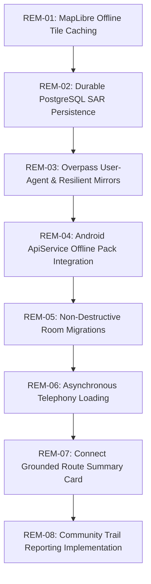

# Prioritized Remediation Plan: Uttarakhand Trek Safety Platform

**Repository Commit**: `8403e98`  
**Active Branch**: `main`  
**Execution Strategy**: Sequential, dependency-ordered resolution across Phases 1 through 5.



---

## 1. Remediation Sequencing Overview

Issues must be resolved in strict dependency order:
$$\text{Base Map Offline Rendering (P0)} \rightarrow \text{Data Durability & Upstream Resiliency (P1)} \rightarrow \text{API Pipeline Completion (P1)} \rightarrow \text{Offline Safety Pack (P2)} \rightarrow \text{AI & Reporting (P3)}$$

| Ticket ID | Priority | Subsystem | Issue Summary | Dependency | Estimated Effort |
| :--- | :--- | :--- | :--- | :--- | :--- |
| **REM-01** | `P0` | Map / Offline | Implement MapLibre `OfflineManager` tile download for planned routes | None | 4 hours |
| **REM-02** | `P1` | Backend / SAR | Migrate SAR check-ins and SOS incidents from memory to PostgreSQL | None | 2 hours |
| **REM-03** | `P1` | Backend / Overpass | Fix Overpass HTTP 406 by enforcing descriptive User-Agent and mirror rotation | None | 1.5 hours |
| **REM-04** | `P1` | Android / API | Add `getRouteOfflinePack` to `ApiService.kt` and consume in `RouteRepository.kt` | REM-01 | 2 hours |
| **REM-05** | `P2` | Android / Room | Replace `fallbackToDestructiveMigration()` with explicit Room migrations | None | 2.5 hours |
| **REM-06** | `P2` | Android / Telephony | Remove synchronous `getLocalCoverageState()` from `ProviderStatusViewModel` constructor | None | 1 hour |
| **REM-07** | `P2` | Backend / UI | Expose `RouteSummaryAssistant` via REST endpoint and render on Review Screen | REM-04 | 3 hours |
| **REM-08** | `P3` | Full Stack | Implement Community Trail Reporting (schema, photo upload, map markers) | REM-01, REM-02 | 6 hours |

---

## 2. Actionable Ticket Specifications

### Ticket REM-01: MapLibre Offline Vector Tile Downloading (`P0` — Critical)
- **Category**: Map & Offline Navigation
- **User-Visible Impact**: When trekkers navigate outside cellular coverage (airplane mode), the map displays a blank white screen instead of topographic trails, contours, and landmarks.
- **Affected Files**:
  - `android/app/src/main/java/com/touristsafety/app/core/map/MapConfig.kt`
  - `android/app/src/main/java/com/touristsafety/app/core/repository/RouteRepository.kt`
  - `android/app/src/main/java/com/touristsafety/app/feature/map/MapScreen.kt`
- **Root Cause**: `OfflineManager` is never called. The app saves route JSON in Room and local files, but never downloads the MapLibre vector style, fonts, sprites, or tiles into `mbgl-offline.db`.
- **Proposed Fix**:
  1. In `RouteRepository.kt`, when `saveRouteOffline()` is called, compute the route bounding box with a 5 km buffer.
  2. Instantiate `OfflineManager.getInstance(context)`.
  3. Define an `OfflineTilePyramidRegionDefinition` specifying:
     - Style URL: `MapConfig.DEFAULT_STYLE_URL` (`https://tiles.openfreemap.org/styles/liberty`)
     - LatLngBounds: Route bounding box
     - Min Zoom: 10.0, Max Zoom: 14.0 (conforming to the 3,000 tile cap)
  4. Call `offlineManager.createOfflineRegion()` and save the region identifier in Room DB.
- **Acceptance Test**:
  1. Plan a route (Dehradun to Mussoorie) and click "Save Offline".
  2. Put Android emulator / device in Airplane Mode (`adb shell cmd connectivity airplane-mode enable`).
  3. Reopen `MapScreen` and verify that vector streets, topography, and trails render cleanly without an internet connection.

---

### Ticket REM-02: Durable PostgreSQL Persistence for SAR Incidents (`P1` — High)
- **Category**: Search and Rescue / Operational Reliability
- **User-Visible Impact**: If the backend server restarts, scales down, or redeploys on cloud PaaS (Render), active trekker emergency distress beacons and check-in histories are permanently erased.
- **Affected Files**:
  - `backend/app/models/sar.py` (New model file or add to `backend/app/models/`)
  - `backend/app/api/v1/sar.py`
  - `backend/app/database/session.py` (Add table to schema migration list)
- **Root Cause**: `backend/app/api/v1/sar.py` uses module-level Python dicts (`_ACTIVE_INCIDENTS`, `_ACTIVE_CHECKINS`) for incident state.
- **Proposed Fix**:
  1. Create SQLAlchemy model `SARIncident` with fields: `incident_id` (UUID primary key), `trip_id`, `device_id`, `latitude`, `longitude`, `elevation_m`, `battery_pct`, `emergency_type`, `status` (`ACTIVE`, `RESOLVED`), `broadcast_timestamp`.
  2. Create model `TrekkerCheckIn` with: `checkin_id`, `trip_id`, `latitude`, `longitude`, `elevation_m`, `status`, `notes`, `created_at`.
  3. Update `POST /api/v1/sar/sos` and `POST /api/v1/sar/check-in` to query and commit through `db: AsyncSession`.
- **Acceptance Test**:
  1. Trigger SOS beacon via `POST /api/v1/sar/sos`.
  2. Restart backend process (`Uvicorn`).
  3. Call `GET /api/v1/sar/incidents/{incident_id}` and verify record persists with exact coordinates.

---

### Ticket REM-03: Resilient Upstream OSM Overpass Querying (`P1` — High)
- **Category**: Geospatial / Data Ingestion
- **User-Visible Impact**: Live emergency facility icons (clinics, police, petrol pumps) fail to refresh when traversing new mountain areas due to Overpass `HTTP 406 Not Acceptable` or `HTTP 504 Gateway Timeout`.
- **Affected Files**:
  - `backend/app/clients/osm_amenities.py`
  - `backend/app/clients/osm_forest.py`
- **Root Cause**: Public Overpass servers block automated requests lacking compliant User-Agent headers. Bounding boxes larger than $0.5^\circ$ frequently hit query memory limits.
- **Proposed Fix**:
  1. Update `httpx.AsyncClient` default headers in `OSMAmenitiesClient`:
     ```python
     headers={
         "User-Agent": "UttarakhandTrekSafety/2.0 (Contact: admin@touristsafety.org; OpenStreetMap Ingestion)",
         "Accept": "application/json",
     }
     ```
  2. Add secondary mirrors: `https://overpass.kumi.systems/api/interpreter`, `https://overpass-api.de/api/interpreter`.
  3. Clamp bounding boxes to maximum $0.35^\circ \times 0.35^\circ$ before issuing QL statements.
- **Acceptance Test**:
  1. Execute Overpass live probe via Python script.
  2. Verify response status is `HTTP 200 OK` and returns $\ge 1$ facility.

---

### Ticket REM-04: Android Client Pre-Trek Offline Pack Integration (`P1` — High)
- **Category**: Android Client / API Pipeline
- **User-Visible Impact**: Android saves unvalidated ad-hoc JSON on disk rather than utilizing the backend's verified `RouteOfflinePack` manifest.
- **Affected Files**:
  - `android/app/src/main/java/com/touristsafety/app/core/network/ApiService.kt`
  - `android/app/src/main/java/com/touristsafety/app/core/network/dto/OfflinePackDto.kt` (New DTO)
  - `android/app/src/main/java/com/touristsafety/app/core/repository/RouteRepository.kt`
- **Root Cause**: `GET /api/v1/routes/{id}/offline-pack` exists on the backend but is absent from `ApiService.kt`.
- **Proposed Fix**:
  1. Add to `ApiService.kt`:
     ```kotlin
     @GET("routes/{id}/offline-pack")
     suspend fun getRouteOfflinePack(@Path("id") id: String): Response<RouteOfflinePackDto>
     ```
  2. In `RouteRepository.kt`, update `saveRouteOffline(routeId)` to call `getRouteOfflinePack(routeId)`, writing the verified server manifest directly to internal disk storage.
- **Acceptance Test**:
  1. Mock or execute `getRouteOfflinePack("test-route-id")`.
  2. Verify returned manifest includes `data_provenance`, `bbox`, `created_at`, `expires_at`, and GeoJSON collections.

---

### Ticket REM-05: Non-Destructive Room Database Migrations (`P2` — Medium)
- **Category**: Android Persistence / UX
- **User-Visible Impact**: Updating the Android application to a new APK version wipes all previously saved offline trips, routes, and emergency contacts.
- **Affected Files**:
  - `android/app/src/main/java/com/touristsafety/app/core/database/DatabaseModule.kt`
  - `android/app/src/main/java/com/touristsafety/app/core/database/AppDatabase.kt`
- **Root Cause**: `DatabaseModule.kt` uses `.fallbackToDestructiveMigration()`.
- **Proposed Fix**:
  1. Define explicit `Migration` objects (e.g. `MIGRATION_9_10`) adding columns via `ALTER TABLE`.
  2. Register migrations in `Room.databaseBuilder(context, AppDatabase::class.java, ...).addMigrations(...)`.
  3. Retain `fallbackToDestructiveMigrationOnDowngrade()` only.
- **Acceptance Test**:
  1. Populate Room DB at version 9.
  2. Bump version to 10 and run migration test.
  3. Verify saved routes and active trip entities remain intact.

---

### Ticket REM-06: Asynchronous Telephony Telemetry Loading (`P2` — Medium)
- **Category**: Android Architecture / Stability
- **User-Visible Impact**: Prevents future regressions of the `SecurityException: getDataNetworkTypeForSubscriber` crash.
- **Affected Files**:
  - `android/app/src/main/java/com/touristsafety/app/feature/providers/ProviderStatusViewModel.kt`
- **Root Cause**: `telephonyManager.getLocalCoverageState()` was called in the synchronous property initializer of `_uiState`.
- **Proposed Fix**:
  1. Initialize `_uiState` with `telephony = null`.
  2. Move `telephonyManager.getLocalCoverageState()` into `viewModelScope.launch(Dispatchers.IO)`.
- **Acceptance Test**:
  1. Launch `ProviderStatusScreen` on an emulator with telephony permissions revoked.
  2. Confirm screen displays "Cellular (Permission Restricted)" without crashing.

---

### Ticket REM-07: Grounded AI Route Summary Card Integration (`P2` — Medium)
- **Category**: AI Services / User Experience
- **User-Visible Impact**: Trekkers do not see the plain-language safety explanation ("Why this route?") citing specific source incident IDs and weather constraints.
- **Affected Files**:
  - `backend/app/api/v1/routes.py`
  - `android/app/src/main/java/com/touristsafety/app/feature/trip/RouteSafetyReviewScreen.kt`
- **Root Cause**: `backend/app/services/ai/route_summary_assistant.py` is implemented but disconnected from API routers and UI screens.
- **Proposed Fix**:
  1. In `backend/app/api/v1/routes.py`, call `route_summary_assistant.generate_grounded_summary()` during `POST /api/v1/routes/{id}/analyze` and include `grounded_summary` in `RouteAnalysisResponse`.
  2. On `RouteSafetyReviewScreen.kt`, add an "Advisory Trail Briefing" card displaying the grounded summary, direct hazard intersections, and safety disclaimers.
- **Acceptance Test**:
  1. Plan a route intersecting a simulated alert.
  2. Verify that the returned summary explicitly names the alert ID and states "directly intersects trail polyline".

---

### Ticket REM-08: Community Trail Condition Reporting (`P3` — Low / Future Extension)
- **Category**: Full Stack / Community Features
- **User-Visible Impact**: Trekkers cannot submit live condition reports (fallen trees, washed-out bridges, rockfalls) with photos from the field.
- **Affected Files**:
  - `backend/app/models/trail_report.py` (New)
  - `backend/app/api/v1/trail_reports.py` (New)
  - `android/app/src/main/java/com/touristsafety/app/feature/report/` (New Screen & ViewModel)
- **Proposed Fix**:
  1. Implement `TrailReport` model: `report_id`, `latitude`, `longitude`, `condition_type`, `passability`, `photo_url`, `created_at`.
  2. Build Compose `ReportTrailConditionScreen` with photo picker, passability selector, and offline outbox queuing.
- **Acceptance Test**:
  1. Submit trail report with GPS coordinates and photo in airplane mode.
  2. Restore connection and verify WorkManager synchronizes the report to backend.

